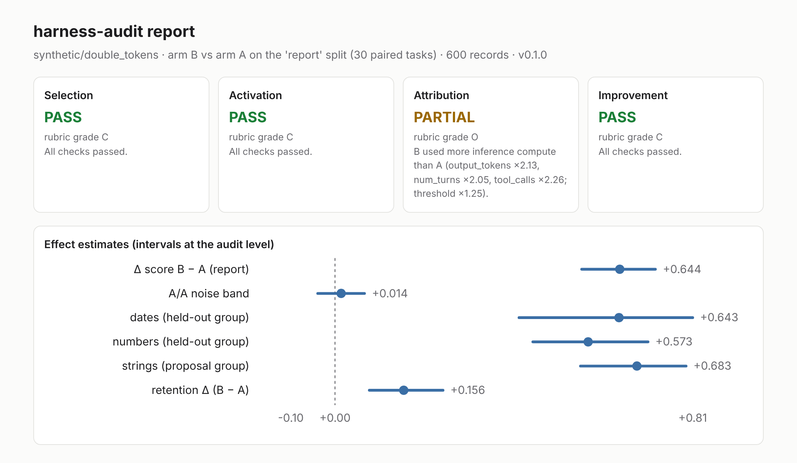

# harness-audit

[](https://github.com/xuan-tu-ai/harness-audit/actions/workflows/ci.yml)
[](LICENSE)

**Did that harness change really make the agent better?** `harness-audit` takes the runs of two
versions of an agent harness (A = before, B = after) and returns a verdict for each of the four claims
that a reported improvement rests on: **Selection, Activation, Attribution, Improvement**. Each verdict
is `PASS`, `PARTIAL`, `FAIL` or `UNKNOWN`, with the reasons and the numbers behind them.

The four claims and their evidence criteria come from *Self-Evolving Agent Harness*
(Wei et al., 2026, [arXiv:2610.18813](https://arxiv.org/abs/2610.18813)) and its companion repository
[zgcagi/Harness-RSI](https://github.com/zgcagi/Harness-RSI) (CC BY 4.0). harness-audit is an independent
implementation; see [Attribution](#attribution-and-citation).



<sub>Report rendered from **synthetic data** (`harness-audit synth --scenario double_tokens`), in which B
wins only by using about twice the output tokens, turns and tool calls. It shows the report format, not a
real result. Real-run results: see [Dogfood results](#dogfood-results).</sub>

## Why

The paper's audit of 93 reported harness-improvement comparisons found that most give evidence of a
clean evaluation split, but few show that the update actually ran in the scored runs or that the gain
exceeds run-to-run noise and extra compute:

| Claim | Met | Partial | Not met |
|---|---:|---:|---:|
| Selection | 43 | 16 | 34 |
| Activation | 8 | 85 | 0 |
| Attribution | 10 | 82 | 1 |
| Improvement | 53 | 18 | 22 |

<sub>Source: Harness-RSI [`docs/reported-evidence.md`](https://github.com/zgcagi/Harness-RSI/blob/main/docs/reported-evidence.md)
(2026-10-17 snapshot), CC BY 4.0. None of the 93 met all four.</sub>

harness-audit makes those checks routine for your own harness changes, in a terminal or in CI.

## Quick start

```bash
pip install "harness-audit @ git+https://github.com/xuan-tu-ai/harness-audit"
```

```bash
harness-audit synth --scenario double_tokens --out demo
```

```bash
harness-audit audit demo/runs.jsonl --manifest demo/manifest.yaml --out demo/report
```

The last command prints the four verdicts and writes `demo/report/report.html`, `report.md` and
`audit.json`. `harness-audit synth --scenario list` shows the other synthetic scenarios, one per planted
defect.

## The four claims

The unit of audit is one **primary comparison**: arm B against arm A on the `report` split. A claim
about one comparison cannot borrow evidence from another model, benchmark or experiment.

| Claim | Question | harness-audit checks |
|---|---|---|
| **Selection** | Was the reported number measured, or picked? | Report tasks are disjoint from the tasks that proposed the update and from the admission tasks (by id and content hash); the report split was not used to choose the round or configuration and was not reused; the paper's admission gate `Δ̂ + sqrt(2·ln(K·T/δ)/m) < 0` on fresh tasks, with `m` counted in **tasks**, not seeds. |
| **Activation** | Did the update operate in the scored runs? | Per changed artifact, the share of scored B runs where it was **available** (loaded), **reached** (its path executed) and **carried** (its effect reached later execution, e.g. a declared trace signature after the skill was invoked). Score difference when the update was activated versus not. |
| **Attribution** | Did the gain come from the update, not noise, compute or the evaluator? | Same evaluator and model; arms differ only in the declared artifacts; inference envelope (output tokens, turns, tool calls) within a ratio of A; paired bootstrap over tasks and a sign-flip permutation test; Δ compared with an A/A noise band. |
| **Improvement** | How far does the gain reach? | Task distance between report tasks and update-forming tasks; gain on task groups that did not form the update; no regression on a retention split beyond your threshold. |

> **Activation** — "*Available*: the artifact entered the run. *Reached*: the changed path executed.
> *Carried*: its effect reached the intended downstream use." — Harness-RSI, `docs/evidence-criteria.md`
>
> **Attribution** — "Full evidence requires three conditions: isolate the update, control inference
> resources, and show a margin beyond measured execution variation." — *ibid.*
>
> "Repeated rollouts reduce execution noise but do not add independent tasks." — Harness-RSI `README.md` §3.2

### Verdicts and rubric grades

Every check has a status: `pass`, `warn` (the rubric's *partial*), `fail` (*not met*), `skip`
(data missing) or `note` (an advisory flag that does not change the verdict). A claim is `FAIL` if any
check fails, `PARTIAL` if any warns or a required check lacks data, `UNKNOWN` if nothing could be
evaluated, else `PASS`. Missing data never yields `PASS`: runs without traces make Activation `UNKNOWN`.

Each claim also reports a **rubric grade** (`C/O/N/U`) computed from the published rubric's own
conditions only. harness-audit is deliberately stricter in three places, and the report shows both:

- Improvement also requires a gain on held-out task groups and non-regression on retention (the rubric
  grades task distance only).
- A changed evaluator or model is `FAIL` for Attribution (the rubric grades it partial).
- The admission gate is reported under Selection; the rubric does not grade it.

The full mapping from each paper criterion to its check, with the exact status rules, is in
[PLAN.md](PLAN.md#2-mapping-from-paper-criteria-to-checks).

### Tested against planted defects

`tests/test_planted.py` generates one synthetic experiment per defect and asserts that the matching
check fires, that the other checks stay quiet, and that a clean experiment passes all four claims:

| Scenario | Planted defect | Caught by | Verdict |
|---|---|---|---|
| `clean` | none | — | PASS ×4 |
| `split_leak` | a third of the report tasks also proposed the update | `split_disjoint_proposal`, `task_distance` | Selection, Improvement PARTIAL |
| `never_activated` | B loads the skill but never invokes it | `reached_or_carried` (+ note "improvement not via the update path") | Activation PARTIAL |
| `double_tokens` | B wins with ~2× output tokens, turns, tool calls | `envelope` | Attribution PARTIAL |
| `evaluator_changed` | B scored by a different evaluator | `same_evaluator` | Attribution FAIL |
| `same_group_only` | gain only on the group that formed the update | `heldout_gain` | Improvement PARTIAL |
| `retention_regression` | B regresses on earlier tasks | `retention` | Improvement FAIL |
| `no_traces` | no traces collected | `reached_or_carried` | Activation UNKNOWN |

## Audit your own runs (any framework)

`harness-audit audit` needs only a JSONL file and, optionally, a manifest. No agent framework is
imported. One line per run:

```json
{"run_id": "r1", "task_id": "t-101", "task_group": "strings", "split": "report", "arm": "B",
 "harness_hash": "sha256:bb", "seed": 0, "model": "my-model", "score": 1.0, "evaluator_hash": "sha256:ev",
 "usage": {"output_tokens": 950, "num_turns": 5, "tool_calls": 8, "cost_usd": 0.0045},
 "events": [{"t": 0, "type": "artifact_loaded", "artifact": "skills/my-skill/SKILL.md"},
            {"t": 2, "type": "artifact_reached", "artifact": "skills/my-skill/SKILL.md", "evidence": "skill invoked"},
            {"t": 3, "type": "tool_call", "name": "Bash", "summary": "pytest -q"}]}
```

(Shown on several lines for reading; each record must be on one line.) Required fields: `run_id`,
`task_id`, `split` (`proposal | admission | report | retention`), `arm` (`A`, `B`, optional `A2` for an
independent A/A replicate), `harness_hash`, `model`, `score` in [0, 1], `evaluator_hash`. Everything else
is optional and only lowers what can be concluded when absent. `events: null` means "not traced";
`events: []` means "traced, nothing happened".

`harness-audit init my-experiment/` writes a commented `manifest.yaml` (changed artifacts and their trace
signatures, the task registry that shows the partition, `K`, `T`, `δ`, how the update was admitted, how
many times the report split has been used, thresholds) and a two-line `runs.example.jsonl`.

Exit codes: `0` no claim at the `--fail-on` level (default `fail`), `1` at least one, `2` input error.

### In CI

```yaml
- uses: xuan-tu-ai/harness-audit@main
  with:
    runs: eval/runs.jsonl
    manifest: eval/manifest.yaml
    fail-on: fail        # or: partial | unknown | never
```

The action appends `report.md` to the job summary and fails the step according to `fail-on`.

## Run mode: Claude Agent SDK

`harness-audit run` runs harness A and B on a task set with the
[Claude Agent SDK](https://code.claude.com/docs/en/agent-sdk/overview), records traces, scores each run
with an evaluator outside the harness, caches the results and audits them.

```bash
pip install "harness-audit[claude] @ git+https://github.com/xuan-tu-ai/harness-audit"
export ANTHROPIC_API_KEY=...            # read by the SDK only; never written to logs, records or cache
harness-audit run examples/experiment.yaml --dry-run
harness-audit run examples/experiment.yaml --max-cost 2.00
```

- **A harness is a directory** (`harness.yaml`, `system_prompt.md`, `skills/<name>/SKILL.md`, …). Its hash
  covers every file. The diff between the A and B directories gives the changed artifacts; a change to
  `max_turns`, `effort` or `thinking` is recorded as a confound, not as the update.
- **Traces**: `artifact_loaded` from the session's `init` message (skills the CLI actually loaded) and for
  the system prompt; `artifact_reached` when the `Skill` tool invokes a changed skill or the agent reads its
  files; `tool_call` for every call, via a `PreToolUse` hook, with a short summary (Bash command or file
  path, never file contents). **Usage** comes from the SDK's `ResultMessage` (tokens, turns, and
  `total_cost_usd`, which the SDK documents as a client-side estimate).
- **Isolation**: each run gets a fresh working directory with the task workspace, `setting_sources=["project"]`
  (no user settings or personal skills), an explicit tool allow-list with `permission_mode="dontAsk"`, and
  an empty `CLAUDE_CONFIG_DIR`. Inherited `CLAUDE_*`/`ANTHROPIC_*` variables other than the API key are
  blanked for the CLI subprocess. A run stops before its first model call if the CLI reports any credential
  source other than `ANTHROPIC_API_KEY`.
- **Cost control**: a real run requires `--max-cost` and asks for confirmation (`--yes` to skip).
  `--dry-run` prints the plan and a cost estimate without calling the API. Before each job the runner
  reserves the per-run cap (`per_run_max_usd`, also passed to the SDK as `max_budget_usd`) and does not start
  a job that could cross `--max-cost`. Results are cached by (task content, harness hash, replicate, model,
  adapter); cached runs cost nothing, and a changed evaluator re-scores cached workspaces instead of
  re-running the agent.
- **Replicates and A/A**: `--seeds N` runs N independent replicates per task and arm (the API has no
  sampling seed). `--aa` adds an `A2` arm, a second independent run of harness A on the report split, to
  measure the noise band.

`examples/` holds a small experiment: 20 Python bug-fix tasks with hidden tests
([tasks/README.md](examples/tasks/README.md)), a baseline harness and the same harness plus one skill
(`python-bugfix`). The default model is `claude-haiku-5-5`. With 3 replicates and the A/A arm it plans 126
runs; the dry-run estimate is $0.58 typical and $6.34 worst case (heuristic, before any real run calibrates
it).

## Dogfood results

**TBD.** The example experiment has not been run with the API yet, so this section has no numbers. It will
show the real report for `examples/` with Claude Haiku once that run has been made and its cost approved.

Expected from the design (not a result): with 5 admission tasks the admission gate cannot pass for any gain
(`ε = 1.095 > 1`), and with 4 held-out-group report tasks the sign-flip test cannot reach p < 0.05. The
report states both limits next to the numbers. A larger task set is needed for those two checks to be able
to pass.

## Write an adapter

An adapter runs one task under one harness and returns events and usage; the runner does the rest. See
[docs/adapters.md](docs/adapters.md). You can also skip adapters entirely and export JSONL from your own
harness.

## Known limitations

- **Activation for interpreted guidance** (system prompts, instructions) is only as good as the trace
  signatures you declare. Adherence can also appear in A, so the report shows the signature's rate in A
  next to its rate in B.
- **Small task sets have little power.** The admission gate needs more than `2·ln(K·T/δ)` tasks even for a
  perfect gain (6 tasks at `K = T = 1`, `δ = 0.05`), and an exact sign-flip test needs at least 6 tasks to reach p < 0.05. The report says when a check
  could not have passed at the given size.
- **Statistics assume independent tasks** and per-task losses in [0, 1], as the paper's gate does.
  Bootstrap intervals with very few tasks are too narrow; the permutation test is the guard.
- **Cost figures are SDK estimates**, not billing data. Cache prices for Claude Haiku 5.5 in the estimator
  use the usual multipliers (read 0.1×, write 1.25× of input) and are an assumption.
- **The agent runs Bash on your machine**, in a temporary directory with an allow-list of tools. Use a
  container for untrusted tasks.
- **Selection inputs that cannot be read from the data** (how the update was admitted, how often the
  report split was used, whether the configuration was chosen on it) come from the manifest and are only as
  accurate as what you declare.
- Retention is checked for the B-vs-A pair at this point in time, not across later updates.
- The rubric's `C/O` boundary is a judgement; harness-audit fixes one reading of it in code. Thresholds are
  configurable in the manifest.

## Development

```bash
uv sync --all-extras
uv run ruff check . && uv run ruff format --check .
uv run pytest
```

## Attribution and citation

The evaluation criteria, and the short quotations of them in this repository, are from Harness-RSI by
Chuyang Wei, Haoxiang Guan, Minghang Zhu, Kexin Zhou, Jiyan He, Xiren Zhou, Huanhuan Chen and Yifei Shen,
licensed [CC BY 4.0](https://creativecommons.org/licenses/by/4.0/). harness-audit's thresholds, check
definitions and verdict mapping are its own and are not endorsed by the original authors (see
[NOTICE](NOTICE)).

```bibtex
@misc{wei2026selfevolvingagentharness,
  title         = {{Self-Evolving Agent Harness}},
  author        = {Wei, Chuyang and Guan, Haoxiang and Zhu, Minghang and
                   Zhou, Kexin and He, Jiyan and Zhou, Xiren and
                   Chen, Huanhuan and Shen, Yifei},
  year          = {2026},
  eprint        = {2610.18813},
  archivePrefix = {arXiv},
  primaryClass  = {cs.AI},
  url           = {https://arxiv.org/pdf/2610.18813}
}
```

To cite harness-audit itself, see [CITATION.cff](CITATION.cff).

## License

Apache-2.0. Copyright 2026 Nguyễn Xuân Tự.
